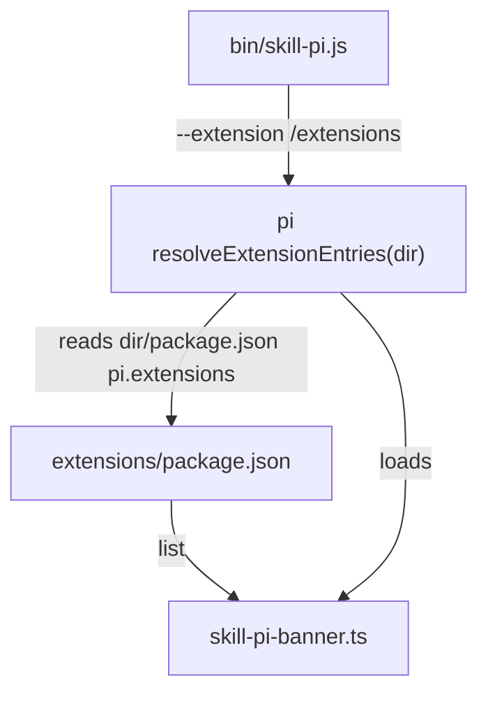

# Change: 001-extension-loading-via-dir-manifest — Load bundled extensions via a dir-level pi manifest

> **STATUS:** `complete` (2026-10-13) — implemented before Skillgrid onboarding; retrofitted into SDD structure.
>
> **For agentic workers:** REQUIRED: follow `.skillgrid/config.yaml` + the SDD structure convention. This file is WHY + HOW. (Historical: authored under the `docs/skillgrid` layout; migrated 2026-10-13.)

**Goal:** Bundled pi extensions load on every skill-pi launch via an explicit `pi.extensions` manifest, matching the mechanism used by `omegon-pi`.

**Architecture:** The wrapper passes `--extension <pkg>/extensions`; pi's `resolveExtensionEntries` reads that dir's own `package.json` `pi.extensions` array and loads the listed files. No new module — the change is a manifest file plus a README update.

**Tech stack:** Node.js 22 ESM, `@earendil-works/pi-coding-agent@1.2.0`

**Research:** none (pi loader traced directly from `dist/bundle/chunks/chunk-TJXZSVTD.js`)

**Prototype:** none

**Ticket:** none

**Depends on:** none

---

## Goal

Every `skill-pi` invocation loads exactly the bundled extensions listed in `extensions/package.json`'s `pi.extensions` array, using the same dir-level manifest mechanism `omegon-pi` uses — with no reliance on alphabetical auto-discovery.

## Out of scope / Non-Goals

- User extensions in `~/.skill-pi/agent/extensions/` (still auto-discovered, unchanged).
- Skills / prompts / themes manifests (only `extensions` is declared).
- pi upstream changes (this is a wrapper-only change).

## Definition of Done

This change is done only when **all** of the following are true:

- [x] `--extension <pkg>/extensions` resolves (via pi's `resolveExtensionEntries`) to exactly the files listed in `extensions/package.json` `pi.extensions`.
- [x] `npm test` config/auth/shim tests pass; the 3 pre-existing failures (`--version`, `--print`, `rpc`) are unchanged by this work (root cause: `ensureAgentDir` + pi 1.2.0 `--extension` dir handling, tracked separately).
- [x] README "Bundled extensions always load" and "Adding your own extensions" describe the manifest.
- [x] ADR 0001 promoted (`.skillgrid/artifacts/04-adr-0001-extension-loading-via-dir-manifest.md`; decision outlives the change).

---

## Problem / why

Bundled extensions previously loaded via directory auto-discovery (every `*.ts` in `extensions/`). The reference distribution `omegon-pi` declares bundled extensions in a `pi.extensions` manifest instead. Aligning with that mechanism gives an explicit, ordered extension list and a stable contract for adding extensions.

## Target users

- skill-pi maintainers — adding/removing bundled extensions
- skill-pi operators — predictable extension load set

## Business rules

- A bundled extension loads only if it is listed in `extensions/package.json` `pi.extensions`.
- User extensions (agent dir) remain auto-discovered — no manifest required.

## In scope

- `extensions/package.json` manifest
- README documentation of the manifest and how to add bundled extensions

## Risks & rollback

- **Risk:** forgetting to list a new extension file in the manifest → it silently doesn't load. **Mitigation:** documented in README; the explicit list is the feature.
- **Risk:** pi loader behavior differs between versions. **Mitigation:** traced against pi 1.2.0 `resolveExtensionEntries`; pinned dependency range.
- **Rollback:** delete `extensions/package.json` — pi falls back to dir auto-discovery, restoring prior behavior.

## Error handling

| Failure | Behavior | Notes |
|---------|----------|-------|
| `extensions/package.json` missing or invalid | `warn+continue` | pi falls back to `index.ts`/`index.js`, then auto-discovery |
| Listed extension path does not exist | `warn+continue` | pi skips missing entries; other entries still load |

## Testing strategy

- **Unit:** `Run: node --test test/config.test.js` — Expected: PASS (agent dir seeding, importAuth)
- **Integration:** `Run: node --test test/` — Expected: 8 pass / 3 pre-existing fail (unchanged by this change; verified by removing the manifest and re-running)
- **Manual trace:** `resolveExtensionEntries('<pkg>/extensions')` → `['<pkg>/extensions/skill-pi-banner.ts']` — verified against pi 1.2.0 loader source
- **Green means:** manifest-resolved file list matches the manifest exactly; pre-existing failure set unchanged

---

## Step Blueprint

| NN | Step slug | Goal (one line) | Primary package / entry | Depends on |
|----|-----------|-----------------|-------------------------|------------|
| 01 | `manifest-dir` | `extensions/package.json` declares bundled extensions in `pi.extensions` | `extensions/` | — |
| 02 | `docs` | README documents the manifest + how to add bundled extensions | `README.md` | 01 |

---

## Technical approach

Add `extensions/package.json` with a `pi.extensions` array listing the bundled extension files. The existing `--extension <pkg>/extensions` flag is unchanged: pi's `resolveExtensionEntries` reads the dir's own manifest and loads the listed files. Update README sections to describe the new contract.

## Architecture decisions

### Decision: manifest lives in `extensions/`, not the repo root

**Module / Interface / Seam / Adapter / Depth:** wrapper ↔ pi extension loader seam; deep module = pi's `resolveExtensionEntries`
**Choice:** `extensions/package.json` (dir-level manifest)
**Alternatives considered:**
1. Repo-root `package.json` `pi.extensions` + `PI_PACKAGE_DIR` env override — rejected: `resolveExtensionEntries` reads only the *dir's own* `package.json`; a root manifest is never consulted when the flag points at `extensions/`. Also made pi treat skill-pi as the active pi package (version/changelog side effects).
2. Keep auto-discovery (no manifest) — rejected: no explicit contract; ordering/files are implicit.
**Rationale:** dir-level manifest is the exact mechanism `omegon-pi` uses, is resolved by pi's own loader with no env tricks, and gives an explicit ordered list.

> Promoted: [`.skillgrid/artifacts/04-adr-0001-extension-loading-via-dir-manifest.md`](../../artifacts/04-adr-0001-extension-loading-via-dir-manifest.md)

### Decision: agent-dir extensions keep auto-discovery

**Choice:** no manifest in `~/.skill-pi/agent/extensions/`
**Alternatives considered:** require a manifest for user extensions — rejected: friction for the "drop a file" use case.
**Rationale:** user extensions are personal; the drop-file workflow must stay zero-config.

## Data flow



## File layout

```
skill-pi/
├── extensions/
│   ├── package.json          # pi manifest (pi.extensions)
│   └── skill-pi-banner.ts
└── README.md                 # manifest documented
```

## Impacted files map

| File | Action | Step | Description |
|------|--------|------|-------------|
| `extensions/package.json` | Create | 01 | `pi.extensions` manifest listing bundled extensions |
| `README.md` | Modify | 02 | document manifest + how to add bundled extensions |

## Per-step WHAT

### Step 01 — `manifest-dir`

**Goal:** pi resolves `--extension <pkg>/extensions` to exactly the files listed in the manifest.
**Out of scope:** agent-dir extensions, skills/prompts/themes.
**Definition of Done:** traced loader output equals the manifest list.

- `extensions/package.json` exists with `pi.extensions: ["./skill-pi-banner.ts"]`.
- Removing the manifest makes pi fall back to auto-discovery (prior behavior).

### Step 02 — `docs`

**Goal:** a maintainer can add a bundled extension by reading the README.
**Out of scope:** other README sections.
**Definition of Done:** both sections describe the manifest contract.

- "Bundled extensions always load" names `extensions/package.json` as the source of the list.
- "Adding your own extensions" says: add file to `extensions/` + list it in `pi.extensions`.

## Threat matrix

| Boundary / threat | Applicable? | Owning step | Planned RED coverage |
|-------------------|-------------|-------------|----------------------|
| Manifest lists a missing file → partial load | Applicable | 01 | manual trace: skip-missing-entry behavior documented in Error handling |
| Loader reads wrong package.json (root vs dir) | Applicable | 01 | traced `resolveExtensionEntries` source (pi 1.2.0) before choosing dir-level |
| User extension workflow broken | N/A: agent dir keeps auto-discovery | — | — |

## Migration / rollout

- N/A: additive file; no existing state migrates. `docs` added to npm `files` so the ADR ships.

## Open questions

- Pre-existing `--extension <dir>` failure when the dir is seeded but empty (`ensureAgentDir`) — track as a separate change.

## Glossary

| Term | Definition | Glossary file |
|------|------------|---------------|
| **pi manifest** | `pi` field of a `package.json` with resource arrays pi resolves per `--extension` dir | technical |
| **manifest dir** | directory whose own `package.json` carries the manifest (`extensions/`) | technical |

## Author self-review

- [x] **Goal**, **Out of scope / Non-Goals**, and **Definition of Done** are filled and testable
- [x] **Error handling** and **Testing strategy** are filled
- [x] Non-goals match Global Constraints that will appear in `tasks.md`
- [x] Rollback plan is present
- [x] Step Blueprint covers a vertical-slice sequence (no horizontal-only layers)
- [x] Every Impacted Files row maps to exactly one step
- [x] Every applicable threat row names an owning step
- [x] Glossary terms reused or defined; no companion reference file
