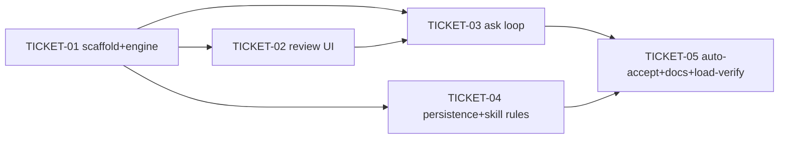

# Tasks — Permission Extension (Opencode-style)

> **STATUS:** `sliced` (2026-10-14)

> Sliced from `.skillgrid/specs/2026-10-14-permission-extension/blueprint.md`.
> Vertical tracer-bullet tickets, dependency-ordered, sized for one fresh agent context window.

## Epic Summary

Port the `pi-opencode-permissions-and-preview` `permission` extension into
`skill-pi` as a self-contained `extensions/permission/` bundle: a `tool_call`
permission gate (allow/deny/ask/always rules, AST-aware bash, conf.d
persistence per ADR 0008), a Pierre-backed `edit`/`write` diff review, and an
auto-accept toggle. Tracer-thread build shape — the load-verify door check (Task
1) proves the extension loads before the review UI is invested in.

## Delivery Strategy

| Field | Value |
|-------|-------|
| Estimated changed lines | ~3,400 (port) + ~150 (deps/docs/tests) |
| 400-line budget risk | High |
| Chained PRs recommended | Yes |
| Suggested split | PR 1 (scaffold+engine) → PR 2 (review UI) → PR 3 (ask loop) → PR 4 (persistence+skill rules) → PR 5 (auto-accept+docs+load-verify) |
| Delivery strategy | ask-on-risk |
| Chain strategy | stacked-to-main |

Decision needed before apply: Yes
Chained PRs recommended: Yes
Chain strategy: stacked-to-main
400-line budget risk: High

### Suggested Work Units

| Unit | Goal | Likely PR | Focused test command | Runtime harness | Rollback boundary |
|------|------|-----------|----------------------|-----------------|-------------------|
| 1 | Scaffold + conf.d settings loader + rule engine (tracer thread, door check) | PR 1 | `cd extensions/permission && npx vitest run rules.spec.ts project.spec.ts && npx tsc --noEmit` | Load-verify: `node bin/skill-pi.js --agent-dir /tmp/pa --no-shim /tmp/pp --print "ok"` (backstop T7/T8) | `extensions/permission/` (new) + root `package.json` deps |
| 2 | Edit/write diff preview + Pierre review dialog | PR 2 | `cd extensions/permission && npx vitest run preview.spec.ts && npx tsc --noEmit` | N/A + reason: TUI render is unit-smoke only; full dialog covered by the PR 5 load-verify | `extensions/permission/{review-preview,review-dialog,pierre-*}.ts` (new) |
| 3 | Full ask prompt loop + reject-with-feedback + auto-feedback rejection | PR 3 | `cd extensions/permission && npx vitest run prompt.spec.ts && npx tsc --noEmit` | N/A + reason: prompt loop is UI-driven; covered by PR 5 load-verify + manual gate | `extensions/permission/index.ts` ask branch |
| 4 | conf.d persistence (lock+atomic) + skill-derived allow rules + `.pi` fallback | PR 4 | `cd extensions/permission && npx vitest run persist.spec.ts && npx tsc --noEmit` | Temp-dir fs write (backstop T4) | `extensions/permission/{index.ts persist*, project.ts fallback}` |
| 5 | Auto-accept toggle + status + commands + dep-policy docs + load-verify | PR 5 | `cd extensions/permission && npx tsc --noEmit && npx vitest run; cd ../.. && node --test "test/**/*.test.js"` | Full wrapper load + root suite (backstop T7) | `extensions/permission/index.ts` tail + `config.yaml`/`AGENTS.md`/`README.md` |

> The four plain-text guard lines above are the **contract** — `skillgrid:subagent-execution` matches them literally. Risk is High, so `Chained PRs recommended` is `Yes` and every work unit names a focused test, a runtime harness (or `N/A` + reason), and a rollback boundary.

## Tickets

### TICKET-01 — Scaffold + conf.d settings loader + rule engine (tracer thread)

- **Scope:** New `extensions/permission/` subdir: `index.ts` (entry + `tool_call` resolver), `constants.ts`, `models.ts`, `project.ts` (conf.d loader, ADR 0008), `bash-arity.ts`, `bash-parser.ts`, `rejection.ts`, `package.json` (private, deps+toolchain), `tsconfig.json`; add the 4 runtime deps to the root `package.json`; unit tests for rule chain + conf.d paths. **Door check:** if the extension does not load (wasm/dep resolution fails), STOP before TICKET-02+.
- **Acceptance:** `npx tsc --noEmit` clean in the extension; `vitest run rules.spec.ts project.spec.ts` green; the 4 deps are in the root `node_modules` and `extensions/permission/node_modules` is absent after a root `npm install`; the rule chain resolves `deny > always > session > ask > allow > defaultMode` and a multi-command bash with one `deny` resolves to `deny`; the load-verify (root suite green + wrapper runs without a load error) passes.
- **SATISFIES:** `happy path rule-chain-resolves-mode`, `happy path extension-loads-and-typechecks`, `happy path deps-resolve-at-root`
- **Files:** `extensions/permission/{index,constants,models,project,bash-arity,bash-parser,rejection}.ts`, `extensions/permission/{package.json,tsconfig.json}`, `package.json`, `extensions/permission/{rules,project}.spec.ts` (~1,100)
- **Size:** ~1,100 (L)
- **Blocks:** TICKET-02, TICKET-03, TICKET-04, TICKET-05
- **Blocked by:** none
- **Precondition:** `node -v` ≥ 22.19 and `@earendil-works/pi-coding-agent@1.2.0` present in root `node_modules` (run `node -e "console.log(require('@earendil-works/pi-coding-agent/package.json').version)"`)
- **Fails-when:** `npx tsc --noEmit` exits non-zero, OR any vitest spec fails, OR the load-verify command errors on an unresolved `@pierre/*` / `web-tree-sitter` / wasm path

### TICKET-02 — Edit/write diff preview + Pierre review dialog

- **Scope:** Port `review-preview.ts`, `review-dialog.ts`, `pierre-highlight.ts`, `pierre-metadata.ts`, `pierre-rows.ts`, `pierre-theme.ts`, `pierre-types.ts`; wire `promptForPermission` in `index.ts` to route `edit`/`write` through the preview + dialog; unit tests for preview construction (valid edit, missing file, non-unique oldText, new-file write).
- **Acceptance:** `npx tsc --noEmit` clean; `vitest run preview.spec.ts` green (valid edit → `diff` preview with addedLines>0; missing file → `error`; non-unique oldText → `error`; new-file write → `new-file`); the render smoke on a fixed diff preview returns a non-empty, width-bounded `string[]`.
- **SATISFIES:** `happy path edit-review-diff`
- **Files:** `extensions/permission/{review-preview,review-dialog,pierre-highlight,pierre-metadata,pierre-rows,pierre-theme,pierre-types}.ts`, `extensions/permission/index.ts` (promptForPermission), `extensions/permission/preview.spec.ts` (~1,500)
- **Size:** ~1,500 (L)
- **Blocks:** TICKET-03
- **Blocked by:** TICKET-01
- **Fails-when:** `npx tsc --noEmit` exits non-zero, OR `preview.spec.ts` fails, OR the render smoke returns an empty/unbounded line list

### TICKET-03 — Full ask prompt loop + reject-with-feedback + auto-feedback rejection

- **Scope:** Complete the `tool_call` handler's `ask` branch in `index.ts`: the 5-choice prompt loop, `Allow always` → `getApprovalRules` → `confirmApprovalRules` → `persistApprovalRules`, `Allow always for session`, and reject / reject-with-feedback → block/abort/continue. Unit tests for `resolvePermissionRejection` + `buildHardRejectedReason`.
- **Acceptance:** `npx tsc --noEmit` clean; `vitest run prompt.spec.ts` green (Reject → hard with reason; Reject-with-feedback → feedback kind with trimmed text; empty feedback → back); the `ask` branch maps every `PERMISSION_CHOICES` outcome to a block/allow/abort; a preview-build error returns an automatic block with that error as the reason.
- **SATISFIES:** `happy path ask-reject-with-feedback`, `happy path rule-chain-resolves-mode`
- **Files:** `extensions/permission/index.ts` (ask loop, getApprovalRules, confirmApprovalRules), `extensions/permission/prompt.spec.ts` (~500)
- **Size:** ~500 (M)
- **Blocks:** none
- **Blocked by:** TICKET-01, TICKET-02
- **Fails-when:** `npx tsc --noEmit` exits non-zero, OR `prompt.spec.ts` fails, OR an `ask` outcome maps to no block/allow/abort

### TICKET-04 — conf.d persistence (lock+atomic) + skill-derived allow rules + `.pi` fallback

- **Scope:** Port `persistApprovalRules`, `withPersistentApprovalLock`, `writeOwnSettingsFileAtomic`, `loadOwnSettingsFile`, `getDerivedSkillAllowState`, `getSkillAllowedRules`, `mergeSkillAllowRules` into `index.ts`; change the persistence path to `project.ts`'s conf.d project path (ADR 0008); add the ADR 0008 D2 `.pi/conf.d/` fallback read to `project.ts`. Unit tests for persistence (dedupe, lock cleanup) + skill-derived rules.
- **Acceptance:** `npx tsc --noEmit` clean; `vitest run persist.spec.ts` green (a rule appended twice appears once; the lock file is removed after the write; invalid conf.d JSON throws with path+message); `getDerivedSkillAllowState` returns the union of two skills' `allowed-tools` rules and short-circuits on an unchanged cache key.
- **SATISFIES:** `happy path persist-always-rule`, `happy path skill-derived-allow-rules`
- **Files:** `extensions/permission/index.ts` (persist*, skill rules), `extensions/permission/project.ts` (`.pi` fallback), `extensions/permission/persist.spec.ts` (~600)
- **Size:** ~600 (M)
- **Blocks:** none
- **Blocked by:** TICKET-01
- **Fails-when:** `npx tsc --noEmit` exits non-zero, OR `persist.spec.ts` fails, OR the lock file persists after a successful write

### TICKET-05 — Auto-accept toggle + status + commands + dep-policy docs + load-verify

- **Scope:** Port `toggleAutoAcceptEdits`, `syncSessionStatus`, the `session_start` handler, `/permission-toggle-auto-accept` + `/permission-settings` commands, and the optional `keybindings.autoAcceptEdits` shortcut into `index.ts`; update `.skillgrid/config.yaml` `dependency_policies`, `AGENTS.md` dep-policy line, and `README.md` "Currently bundled" list; final load-verify (root suite + wrapper runs the extension with no load error).
- **Acceptance:** `npx tsc --noEmit` clean; full `vitest run` green in the extension; `node --test "test/**/*.test.js"` green at the root; the wrapper runs the permission extension with no load error (backstop T7); the dep-policy line reads "pi + bundled-extension runtime deps" in both `config.yaml` and `AGENTS.md`; the README lists `permission`.
- **SATISFIES:** `happy path toggle-auto-accept`, `happy path extension-loads-and-typechecks`
- **Files:** `extensions/permission/index.ts` (auto-accept + commands), `.skillgrid/config.yaml`, `AGENTS.md`, `README.md`, `extensions/permission/autostatus.spec.ts` (~300)
- **Size:** ~300 (S)
- **Blocks:** none
- **Blocked by:** TICKET-01, TICKET-03, TICKET-04
- **Fails-when:** `npx tsc --noEmit` exits non-zero, OR the root `node --test` suite fails, OR the wrapper load-verify errors, OR the dep-policy line is not updated in both files

## Dependency Graph

## Execution Order

- **Wave 1:** TICKET-01 (scaffold + engine + door check — must land before anything else; it is the tracer thread)
- **Wave 2 (parallel):** TICKET-02 (review UI), TICKET-04 (persistence + skill rules)
- **Wave 3:** TICKET-03 (ask loop — after TICKET-02's preview routing)
- **Wave 4:** TICKET-05 (auto-accept + docs + final load-verify — after TICKET-03 + TICKET-04)

> **Acceptance-first (BDD is always on):** each ticket's `SATISFIES` scenario is confirmed RED in its Step 1/2 before the implementation that makes it green. The load-verify (TICKET-01 door check, TICKET-05 final) is the `backstop` for T7/T8 — it is the only check that proves the extension loads, and it is ordered first and last.

## Slicing Notes

- **Tracer-thread first wave:** TICKET-01 is the thin end-to-end path (extension loads → a `tool_call` resolves → the right outcome). It carries the door check: if the wasm/deps don't resolve at load, we stop before investing in the review UI. This is the recorded build shape from the blueprint.
- **Parallelism:** TICKET-02 and TICKET-04 are independent once TICKET-01 lands (review UI vs. persistence) — they can run in parallel worktrees. TICKET-03 waits on TICKET-02 (the ask loop routes through the preview). TICKET-05 is the final thickening + docs + backstop.
- **Why 5 tickets, not 1:** the ~3,400-line port is High-risk for the 400-line review budget. Slicing by the blueprint's 5 tasks gives 5 chained PRs (stacked-to-main per config `delivery.chain_strategy`), each with a clear rollback boundary (a new file or a single `index.ts` branch) and a focused test command.
- **Assumption (ADR 0002 dependency):** the project-scope `.skill-pi/conf.d/` write only works once ADR 0002's `piConfig.configDir` + shim-retirement lands. Until then the resolver writes to the conf.d path derived from `getAgentDir()` (user) and the git-root `conf.d/` (project); the `.pi/conf.d/` fallback read (TICKET-04) is the documented ADR 0008 D2 exception. If the shim is still live at execution time, the project conf.d path is the git-root `conf.d/` (the ADR 0008 D2 rule 2), which is correct for stock-pi compat.
- **No wrapper change:** per ADR 0001, `collectExtensionFiles` already picks up `extensions/permission/index.ts`. No edit to `bin/skill-pi.js` is in any ticket — the load-verify (TICKET-01 door check, TICKET-05) is the proof.
