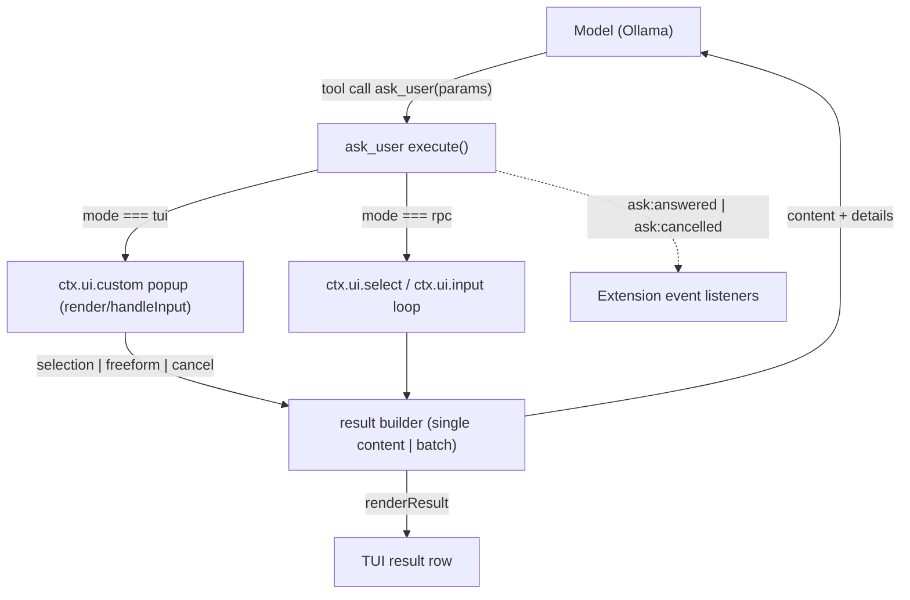

# Change: 001-ask-user — Bundled `ask_user` extension

> **STATUS:** `approved`
>
> **For agentic workers:** REQUIRED: follow `.skillgrid/config.yaml` conventions. This file is WHY + HOW. Spec phase instantiates `tasks.md` + `acceptance.feature` from the Step Blueprint and per-step WHAT below.

**Goal:** skill-pi ships a bundled `ask_user` tool so the agent can pause and collect one focused decision (2–5 options, multi-select, freeform) or a batch of 2–4 independent decisions with a review page, in TUI and RPC modes.

**Architecture:** One self-contained TypeScript extension (`extensions/ask-user.ts`) registered in the existing bundled-extensions manifest. The tool renders a custom popup via `ctx.ui.custom` in TUI mode and falls back to `ctx.ui.select`/`ctx.ui.input` dialogs in RPC mode; no other extension or wrapper change is needed because the wrapper already loads every extension listed in `extensions/package.json`.

**Tech stack:** Node.js 22 ESM, TypeScript, `@earendil-works/pi-coding-agent` 1.2.0 extension API (`registerTool`, `ctx.ui.custom`, TypeBox), `node-pty` (E2E only), local Ollama (E2E model).

**Research:** in-conversation (2026-10-13): pi-ask-user (edlsh), my-pi-setup ask-user (davis7dotsh), gentle-shell ask-user-choice/question (Gentleman-Programming) — feature and API comparison.

**Prototype:** none

**Ticket:** none

**Depends on:** none

---

## Goal

A `skill-pi` session can call `ask_user`: the user sees an interactive popup (TUI) or dialogs (RPC), answers one question or a batch with a review page, and the agent receives a structured answer — selection(s), freeform text, or cancellation — that is reconstructible from the tool result's `details`.

## Out of scope / Non-Goals

- Searchable option filter (pi-ask-user feature; deferred)
- Overlay/inline display-mode toggle key and context-collapse UI (pi-ask-user feature; deferred)
- Optional comment/extra-context row (`allowComment`); deferred
- Auto-dismiss timeout parameter; deferred
- Per-user env-var defaults (`PI_ASK_USER_*`); deferred
- Bundled `ask-user` skill (SKILL.md) nudging the model; deferred
- Windows support for the PTY-based E2E test (Linux `node-pty` only)
- No changes to `bin/`, `lib/`, or the pi wrapper itself — this change touches only `extensions/`, `test/`, `package.json`, `README.md`

## Definition of Done

This change is done only when **all** of the following are true:

- [ ] `ask_user` is registered and callable in a live `skill-pi` TUI session; selecting an option, typing a freeform answer, or pressing Esc each produce the correct model-facing result and rendered result row
- [ ] Batch mode (2–4 questions) works: tab through pages, review page shows all answers, submit returns index-aligned answers with skips
- [ ] Multi-select questions commit an explicit set of selected options (never a partial state)
- [ ] RPC mode answers the same questions through `select`/`input` dialogs with the same `details` shapes
- [ ] All `@step-NN` Features in `acceptance.feature` pass (`@happy`, `@edge`, `@failure` per step)
- [ ] `node --test "test/**/*.test.js"` is green including the new unit and E2E tests (E2E skips cleanly when Ollama is unreachable)
- [ ] Rollback path below is still valid
- [ ] Change archived under `.skillgrid/archive/2026-10-13-ask-user/`

---

## Problem / why

skill-pi has no way for the agent to ask the user a decision mid-run: the model either guesses or interrupts the flow with plain text. Every reference implementation (pi-ask-user, my-pi-setup, gentle-shell) exists because this is a first-class need. skill-pi's value proposition is a curated set of bundled extensions, so `ask_user` is the natural first one.

## Target users

- skill-pi operator — mid-agent-run, the agent needs a decision (branch choice, target environment, ambiguous requirement) and should not guess
- skill-pi maintainer — wants a known-good baseline `ask_user` before considering third-party ask-user packages (tool-name exclusivity makes coexistence impossible)

## Business rules

- Tool name `ask_user` is exclusive across extensions in pi (a name conflict is a hard load error); no other bundled extension may register the same name
- Cancellation is not an answer: a cancelled single question returns `answer: null`; a cancelled batch cancels every question
- Multi-select never commits a partial selection silently: only an explicit "Done" (or all options toggled on) commits
- Exactly one of `question` or `questions` per call; 2–5 options per question; 2–4 questions per batch
- Non-interactive modes without dialog-capable UI return a graceful "unavailable" result, never a hang

## In scope

- `extensions/ask-user.ts`: `ask_user` tool (single + batch + multi-select + freeform), TUI popup, RPC dialog fallback, structured `details`, `renderCall`/`renderResult`, `promptSnippet`/`promptGuidelines`, `ask:answered`/`ask:cancelled` events
- `extensions/package.json`: register the extension
- `test/ask-user.test.js`: unit tests (mocked ctx)
- `test/ask-user-e2e.test.js`: PTY E2E against local Ollama
- `package.json`: `node-pty` devDependency
- `README.md`: bundled-extensions documentation

## Risks & rollback

- **Risk:** small local models flakily emit the `ask_user` tool call in E2E — **Mitigation:** E2E uses a function-calling-capable model and a deterministic prompt ("Use the ask_user tool now…"); test skips (not fails) when Ollama is unreachable or the tool call does not appear within the timeout
- **Risk:** `node-pty` native build fails in some environments — **Mitigation:** E2E test skips gracefully when `node-pty` fails to load (dynamic import, `t.skip()`)
- **Rollback:** remove `./ask-user.ts` from the `pi.extensions` array in `extensions/package.json` (one line); the tool disappears on next launch. No user data or session state is written by the extension, so no migration is needed. Reverting the commit is complete rollback.

## Error handling

| Failure | Behavior | Notes |
|---------|----------|-------|
| `question` and `questions` both present (or neither) | `abort` (tool result `isError`, message names the fix) | schema is flat by design; runtime validation |
| < 2 or > 5 options on a question | `abort` (tool result `isError`) | |
| > 4 questions in a batch | `abort` (tool result `isError`) | |
| Non-TUI mode without dialog-capable UI | `warn+continue` — graceful "ask_user is unavailable outside interactive modes" result, `cancelled: true` | model sees a clear text result |
| User cancels (Esc / dialog undefined) | success result with `cancelled: true`, `answer: null` | not an error — the model is told the user declined |
| Multi-select round cap hit without Done | treated as cancel (no partial commit) | cap = max(32, options.length + 2) |
| Aborted tool call (agent interrupted while prompt open) | prompt dismisses, result `cancelled: true` | via `ctx.signal` |
| Ollama unreachable during E2E | `warn+continue` — test skips | `t.skip()` |

## Testing strategy

- **Unit:** `Run: node --test test/ask-user.test.js` — Expected: PASS
- **E2E (PTY + Ollama):** `Run: node --test test/ask-user-e2e.test.js` — Expected: PASS (skips when Ollama unreachable)
- **Full suite:** `Run: npm test` — Expected: PASS
- **Green means:** all unit scenarios green; E2E green or skipped with a logged reason; no regressions in existing `test/*.test.js`

---

## Step Blueprint

Contract for `sdd-spec`. Do not renumber after `tasks.md` exists.

| NN | Step slug | Goal (one line) | Primary package / entry | Depends on |
|----|-----------|-----------------|-------------------------|------------|
| 01 | `tool-contract` | `ask_user` tool registered with schema, validation, result `details` shapes, events, renders — verified by unit tests against a mocked ctx | `extensions/ask-user.ts` | — |
| 02 | `tui-interaction` | TUI popup: single-select, multi-select, freeform, batch pages + review page; RPC dialog fallback | `extensions/ask-user.ts` | 01 |
| 03 | `e2e-harness` | PTY E2E against local Ollama: real TUI, scripted keys, asserted result rows; ships in `npm test` | `test/ask-user-e2e.test.js` | 01, 02 |

---

## Technical approach

Single extension file registering one tool. `execute()` branches on `ctx.mode`: TUI builds a custom `Component` (render/handleInput/dispose) inside `ctx.ui.custom` — a davis7dotsh-style popup extended with multi-select toggle rows and a paged batch view with a review page (pi-ask-user pattern); RPC loops `ctx.ui.select` (toggle-rounds for multiSelect, bounded) and `ctx.ui.input` (freeform) — gentle-shell pattern. All paths return the same `details` shapes so renderers and session state behave identically across modes. Unit tests drive `execute()` directly with a mocked `ExtensionAPI`/`ExtensionToolContext`. E2E spawns the real binary in a `node-pty` PTY with a temp agent dir pointing at Ollama.

## Architecture decisions

### Decision: One `ask_user` tool, not split choice/question tools

**Module / Interface / Seam / Adapter / Depth:** tool interface seam with pi's extension loader
**Choice:** single tool `ask_user` whose params accept either one question or a `questions` batch
**Alternatives considered:** gentle-shell's two-tool split (`ask_user_choice` + `ask_user_question`); pi-ask-user's single tool (adopted)
**Rationale:** one tool name is easier for models to use correctly; pi-ask-user proves the merged shape at scale. Two tools double the prompt-surface area for marginal gain. Tool names are exclusive across extensions, so committing to one name now also blocks third-party ask-user packages (intended — we bundle our own).

### Decision: Flat TypeBox schema + runtime validation

**Choice:** flat `Type.Object` (no `anyOf`), mutual exclusivity of `question`/`questions` and option-count bounds validated at the top of `execute()`
**Alternatives considered:** `anyOf`/`union` TypeBox schema
**Rationale:** pi-ask-user documents that some provider proxies strip or reject `anyOf`; a flat schema is the resilient choice. Validation errors return an `isError` tool result (not a throw) so the model can self-correct.

### Decision: Same `details` shapes across TUI and RPC

**Choice:** `execute()` funnels both UI paths into one result builder
**Alternatives considered:** per-mode result shapes (gentle-shell keeps them identical but in separate functions)
**Rationale:** `renderResult`, session-state reconstruction, and unit tests all depend on one shape contract. A divergence between modes is a bug class we should not allow.

### Decision: `node-pty` + local Ollama for E2E, with graceful skip

**Choice:** E2E test uses `node-pty` (devDependency) to drive a real TUI; model is a local Ollama endpoint configured via a temp agent dir's `models.json` (`openai-completions` API, dummy key)
**Alternatives considered:** RPC-mode-only E2E (no PTY); mocking the provider in-process; Linux `script -qec` with zero new deps
**Rationale:** the popup interaction (keys, review page, Esc) only exists in TUI mode, so a PTY is the honest E2E. Ollama is already available locally and pi supports it through `models.json`. Skip-on-unreachable keeps `npm test` green in CI without Ollama.

### Decision: Events, not hooks, for outcome signaling

**Choice:** emit `ask:answered` / `ask:cancelled` (question + response kind only; full data stays in `details`)
**Alternatives considered:** none (matches pi-ask-user convention)
**Rationale:** forward-compatible with hosts that want to correlate prompt lifecycle; zero cost for hosts without listeners.

## Data flow



## File layout

```
skill-pi/
├── extensions/
│   ├── package.json          # + "./ask-user.ts" in pi.extensions
│   ├── ask-user.ts           # new: the extension (tool + UI + fallback)
│   └── skill-pi-banner.ts    # untouched
├── test/
│   ├── ask-user.test.js      # new: unit tests (mocked ctx)
│   ├── ask-user-e2e.test.js  # new: PTY + Ollama E2E
│   └── ...                   # untouched
├── package.json              # + node-pty devDependency
└── README.md                 # + bundled-extensions section
```

## Impacted files map

| File | Action | Step | Description |
|------|--------|------|-------------|
| `extensions/ask-user.ts` | Create | 01 | tool registration, schema, validation, `details` shapes, events, renders, RPC fallback |
| `extensions/package.json` | Modify | 01 | register `./ask-user.ts` in `pi.extensions` |
| `test/ask-user.test.js` | Create | 01 | unit tests for contract (RED tasks in 01/02) |
| `package.json` | Modify | 01 | `node-pty` devDependency |
| `README.md` | Modify | 01 | document bundled `ask_user` extension |
| `extensions/ask-user.ts` | Modify | 02 | TUI popup component (single/batch/multi-select/freeform) |
| `test/ask-user.test.js` | Modify | 02 | unit coverage for mode routing + RPC fallback paths |
| `test/ask-user-e2e.test.js` | Create | 03 | PTY E2E harness + scenarios |
| `package.json` | Modify | 03 | E2E timeout / Ollama env config if needed |

## Per-step WHAT

### Step 01 — `tool-contract`

**Goal:** the `ask_user` tool exists, validates its inputs, and produces the full contract surface (result `details` shapes, renders, prompt text, events, RPC fallback) — proven by unit tests without a terminal.
**Out of scope:** the TUI popup component itself (lands in 02); E2E (03).
**Definition of Done:** all `@step-01` scenarios pass against a mocked ctx; extension loads cleanly in a real pi process (banner session still starts).

- The tool is registered as `ask_user` with 2–5 options per question and 2–4 questions per batch
- Calling with both `question` and `questions` (or neither) yields an error result naming the fix
- Calling with a valid single question in RPC mode answers through `select`/`input` dialogs and returns `{question, options, answer, cancelled:false}` details
- Selecting an option returns `answer: {kind:"selection", selections:[label]}`; freeform returns `answer: {kind:"freeform", text}`; dialog cancel returns `cancelled: true, answer: null`
- A multi-select question commits only on explicit Done; hitting the round cap without Done cancels (no partial commit)
- A batch of 2 returns `kind:"batch"` with index-aligned answers; cancelling any question cancels the whole batch
- A non-dialog mode returns a graceful unavailable result (not a hang, not a throw)
- `renderCall` summarizes the question + option labels (truncated ≤120 chars for batches); `renderResult` shows `✓ …` for answers and a warning for cancellation
- `ask:answered` / `ask:cancelled` events fire exactly once per resolved call
- The extension is listed in `extensions/package.json` and `skill-pi` still starts (banner notification still fires)
- `ask_user` is documented in README.md

### Step 02 — `tui-interaction`

**Goal:** the TUI popup delivers the interactive experience — single-select, multi-select, freeform editor, and paged batch with review page — in a real TUI session.
**Out of scope:** E2E automation of the popup (03); search filter, comments, timeouts (deferred).
**Definition of Done:** all `@step-02` scenarios pass in a live TUI session (manual or scripted).

- In TUI mode the question renders as a focused popup: numbered options with descriptions, freeform "Type something…" row when `allowFreeform` is not false
- Arrow keys / number keys navigate; Enter confirms the focused option; the agent receives the selection result
- The freeform row opens an inline editor; Esc returns to the options; Enter with non-empty text submits `kind:"freeform"`
- Esc on the options cancels the whole prompt (batch included) with `cancelled: true`
- Multi-select questions show `[ ]`/`[x]` toggle rows plus a Done row; toggling is reversible; Done (or all-on) commits the selected set
- A batch renders one page per question; tab/shift+tab switch pages without losing state
- The review page lists every question with its answer or "skipped"; number keys jump back to a page
- Enter on the review page with unanswered questions warns once; a second Enter submits, recording skips
- Interrupting the agent while the popup is open dismisses it and returns `cancelled: true`

### Step 03 — `e2e-harness`

**Goal:** `npm test` proves the real product: a real `skill-pi` process in a PTY, a real local model, scripted keystrokes, asserted result rows.
**Out of scope:** CI configuration beyond a clean skip; non-Linux PTY support.
**Definition of Done:** all `@step-03` scenarios pass with Ollama up, and skip (not fail) without it.

- E2E spawns the real binary with a temp agent dir whose `models.json` points at a local Ollama endpoint
- A deterministic prompt makes the model call `ask_user`; the test waits for the popup (option labels visible) within a bounded timeout
- Selecting an option via PTY keys yields the `✓ <n>. <label>` result row in the TUI output
- Freeform via PTY keys yields the custom-answer result row
- Esc yields the dismissed/cancelled result row
- A batch prompt renders pages + review; scripted tab/Enter submits and the batch answers render
- When Ollama is unreachable or `node-pty` fails to load, the test skips with a reason; it never fails the suite

## Threat matrix

Core matrix rows (doc-path classification, git repo selection, commit/push state, PR commands) are all `N/A: this change adds no shell, git, or PR automation — it adds a pi extension and node:test files`.

| Boundary / threat | Applicable? | Owning step | Planned RED coverage |
|-------------------|-------------|-------------|----------------------|
| Process integration: PTY spawn/kill + temp agent dir cleanup (E2E harness) | Applicable | 03 | Given the child process hangs or exits early, the PTY test kills the process and removes the temp agent dir without leaking (assert no lingering `skill-pi` process / no leftover temp dir after test) |
| Process integration: Ollama unreachable at E2E time | Applicable | 03 | Given `http://localhost:11434` is not listening, the E2E suite skips every scenario with a reason instead of failing or hanging |
| Shared-convention drift | N/A: no `_shared/conventions/*`, `.skillgrid/config.yaml`, or `AGENTS.md` edits in this change | — | — |
| Mnemonic tool surface | N/A: no `mem_*` / `code_*` contract changes | — | — |

## Migration / rollout

- N/A: purely additive. Existing sessions, auth, and the banner extension are untouched. First launch after upgrade simply has one more tool available.

## Open questions

- None — scope, tool name, PTY library, E2E model, and batch review behavior were settled with the user on 2026-10-13.

## Naming note (ADR-0005)

This change does not rename or publish packages. If `ask_user` is ever split into a
separately published package (per [ADR 0004](../../artifacts/04-adr-0004-extensions-as-separately-published-packages.md)),
its npm name is **`@devopstales/pi-ask-user`** per [ADR 0005](../../artifacts/04-adr-0005-package-naming-devopstales-scope.md)
(`@devopstales` scope, `pi-<name>` pattern). Do not hardcode `@skill-pi/*` in code, tests, or
docs for this extension. See the change's [ADR review manifest](./adr.md) for the full
in-force ADR set.

## Glossary

| Term | Definition | Glossary file |
|------|------------|---------------|
| **ask_user** | Bundled skill-pi pi tool that pauses the agent to collect a user decision (selection, freeform, or multi-select), single or batched | technical |
| **Popup** | The TUI component shown via `ctx.ui.custom` that captures the user's answer with keyboard input | technical |
| **Review page** | Final batch page listing all answers/skips before submission | technical |
| **Dialog fallback** | RPC-mode answer path using `ctx.ui.select` / `ctx.ui.input` instead of the popup | technical |
| **Details** | Structured tool-result payload (`details` field) enabling session-state reconstruction | technical |

## Author self-review

- [x] **Goal**, **Out of scope / Non-Goals**, and **Definition of Done** are filled and testable
- [x] **Error handling** and **Testing strategy** are filled
- [x] Non-goals match Global Constraints that will appear in `tasks.md`
- [x] Rollback plan is present
- [x] Step Blueprint covers a vertical-slice sequence (no horizontal-only layers)
- [x] Every Impacted Files row maps to exactly one step
- [x] Every applicable threat row names an owning step
- [x] Glossary terms reused or defined; no companion reference file
