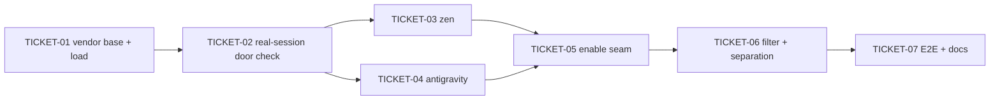

# Tasks — Unified Providers Extension

> **STATUS:** `sliced` (2026-10-15)

> Sliced from `.skillgrid/specs/2026-10-14-unified-providers/blueprint.md`.
> Vertical tracer-bullet tickets, dependency-ordered, sized for one fresh agent context window.

## Epic Summary

Bundle one pi extension (`extensions/providers/`) that registers the union of
three upstream plugins: the `pi-free@2.8.4` base (26 free/paid providers +
filter/telemetry/fallback/quota/diagnostics, vendored as-is), the
`opencode-zen-oauth@1.2.6` provider (device-flow OAuth), and the
`pi-agy@0.6.1` antigravity provider (OAuth multi-account). Tracer-thread build
shape — TICKET-01/02 prove the vendored base loads inside skill-pi before any
OAuth provider is invested in (door check). State stays in `~/.skill-pi/agent`
(per ADR 0002); deps land in `extensions/package.json` (per ADR 0001); no pi
source changes (per ADR 0006).

## Delivery Strategy

| Field | Value |
|-------|-------|
| Estimated changed lines | ~21,000+ (≈20k vendored pi-free dist tree + ~800 OAuth/vendor TS + ~400 tests/docs) |
| 400-line budget risk | High |
| Chained PRs recommended | Yes |
| Suggested split | PR 1 (vendor base + entry + load) → PR 2 (real-session door check) → PR 3 (zen) → PR 4 (antigravity) → PR 5 (enable seam) → PR 6 (filter + separation) → PR 7 (E2E + docs) |
| Delivery strategy | ask-on-risk |
| Chain strategy | stacked-to-main |

Decision needed before apply: Yes
Chained PRs recommended: Yes
Chain strategy: stacked-to-main
400-line budget risk: High

### Suggested Work Units

| Unit | Goal | Likely PR | Focused test command | Runtime harness | Rollback boundary |
|------|------|-----------|----------------------|-----------------|-------------------|
| 1 | Vendor pi-free base + `base.js` shim + entry + deps + load test (door-check part 1) | PR 1 | `node --test test/providers.load.test.js` | Load smoke: stub ExtensionAPI registration capture | `extensions/providers/` (new) + `extensions/package.json` deps |
| 2 | Real-session load smoke (`task providers:load`) — door-check part 2 | PR 2 | `task providers:load` | Real `skill-pi --print` with throwaway `--agent-dir` | `Taskfile.yml` task (new) |
| 3 | Add opencode-zen provider (seam test RED → register) | PR 3 | `node --test test/providers.seam.test.js` | Seam: stub pi registration capture | `extensions/providers/zen/` (new) + `index.ts` line |
| 4 | Add antigravity provider (seam test RED → register) | PR 4 | `node --test test/providers.seam.test.js` | Seam: stub pi registration capture | `extensions/providers/antigravity/` (new) + `index.ts` line |
| 5 | Centralize registration behind `SKILL_PI_DISABLE_PROVIDERS` enable seam | PR 5 | `node --test test/providers.seam.test.js` | Seam: env-forced on/off variants | `extensions/providers/index.ts` |
| 6 | Verify free-filter survival + ADR-0002 state confinement | PR 6 | `node --test test/providers.free-filter.test.js test/providers.separation.test.js` | Temp-dir fs confinement + stub registry | `test/providers.{free-filter,separation}.test.js` (new) |
| 7 | E2E smoke + provenance README + full-suite wiring | PR 7 | `node --test "test/**/*.test.js"` + `SKILL_PI_E2E=1 task providers:e2e` | Real `skill-pi --print` free-model round-trip (skip-guarded) | `test/providers.e2e.test.js` + docs |

> The four plain-text guard lines above are the **contract** — `skillgrid:subagent-execution` matches them literally. Risk is High, so `Chained PRs recommended` is `Yes` and every work unit names a focused test, a runtime harness (or `N/A` + reason), and a rollback boundary.

## Tickets

### TICKET-01 — Vendor the pi-free base and prove it loads (tracer thread)

- **Scope:** Vendor the entire `pi-free@2.8.4` `dist/` tree as-is into `extensions/providers/pi-free/` (+ `package.json` manifest with `main: ./dist/index.js`, `LICENSE`, `CHANGELOG.md`); create the `pi-free/base.js` re-export shim; create the first-version composition entry `extensions/providers/index.ts` (`await base(pi)` only); add the `./providers/index.ts` registration to `extensions/package.json` `pi.extensions` and the runtime deps re-derived from the actual import graph (RED-driven, NOT guessed); add `test/providers.load.test.js` (stub ExtensionAPI capturing `registerProvider`/`registerCommand`/`on`/`registerTool`) + `task providers:test` in `Taskfile.yml`. Per blueprint Task 1. **DOOR CHECK part 1:** if the base does not load under skill-pi's jiti + hoisted deps, STOP before TICKET-02+.
- **Acceptance:** `node --test test/providers.load.test.js` GREEN: (a) `base(stubPi)` returns without throwing, (b) `registerProvider` called ≥ 20 times, (c) `registerCommand` called for `toggle-free` and `pi-free-health`; the entry `import` of `extensions/providers/index.ts` succeeds; `grep -rhoE 'from "[^./][^"]*"' extensions/providers/pi-free/dist/**/*.js | sort -u` deps are all declared in `extensions/package.json` and hoisted into root `node_modules`; `find extensions/providers/pi-free/dist -name '*.js' | wc -l` matches the tarball's 165 count.
- **SATISFIES:** `happy path unified-extension-loads-base`, `edge base-setup-failure-degrades-not-kills`, `failure base-missing-dep-fails-loudly`
- **Files:** `extensions/providers/pi-free/{dist/**,package.json,base.js,LICENSE,CHANGELOG.md}` (new, ~165 vendored JS + 4), `extensions/providers/index.ts` (new, ~8), `extensions/package.json` (MODIFIED: `pi.extensions` + deps), `test/providers.load.test.js` (new, ~120), `Taskfile.yml` (MODIFIED: `providers:test`)
- **Size:** ~20,500 (L — dominated by the ~20k vendored dist tree; authored surface ~200)
- **Blocks:** TICKET-02, TICKET-03, TICKET-04, TICKET-05, TICKET-06
- **Blocked by:** none
- **Precondition:** The three pinned upstream tarballs are fetchable: `npm pack pi-free@2.8.4`, `npm pack opencode-zen-oauth@1.2.6`, `npm pack pi-agy@0.6.1` succeed (or their `node_modules` equivalents exist under `/tmp/skill-pi-vendor/`).
- **Reversibility:** one-way (⚠ vendor ~20k LOC into the tree; the core decision of the change — human checkpoint before committing)
- **Fails-when:** `node --test test/providers.load.test.js` exits non-zero, OR the `.js` count in the vendored `dist/` does not match the tarball count, OR any `from "..."` non-relative import in the vendored tree is not resolvable from the repo root after `npm install`

### TICKET-02 — Prove the base loads in a real skill-pi session (door check)

- **Scope:** Add `task providers:load` to `Taskfile.yml`: launch `skill-pi --print "reply with the word ok"` against a throwaway `--agent-dir` (`$TMPDIR/skill-pi-providers-<ts>`), capture stdout+stderr, and assert (a) exit 0, (b) the pi-free `logStartupSummary` marker appears (confirm exact text from `extensions/providers/pi-free/dist/lib/startup-timing.js`), (c) no `ERR_MODULE_NOT_FOUND`. Per blueprint Task 2. **DOOR CHECK part 2:** a rejected provider setup in the real session is a *finding* (name it + reason in the log), not a silent pass.
- **Acceptance:** `task providers:load` exits 0 with the startup summary marker present and zero `ERR_MODULE_NOT_FOUND` lines; if any provider setup rejected, the log names it (recorded in the task output).
- **SATISFIES:** `happy path base-runs-in-real-session`, `failure base-real-session-provider-setup-rejected`
- **Files:** `Taskfile.yml` (MODIFIED: `providers:load`)
- **Size:** ~60 (S)
- **Blocks:** TICKET-03, TICKET-04, TICKET-05, TICKET-06, TICKET-07
- **Blocked by:** TICKET-01
- **Fails-when:** `task providers:load` exits non-zero, OR the startup summary marker is absent from the captured log, OR the log contains `ERR_MODULE_NOT_FOUND`

### TICKET-03 — Add the opencode-zen provider (OAuth, device flow)

- **Scope:** Vendor `opencode-zen-oauth@1.2.6` `src/{auth,models,free-tier,v2-gate}.ts` verbatim into `extensions/providers/zen/` (+ `LICENSE`); create `extensions/providers/zen/provider.ts` lifting the upstream `src/extension.ts` body into a named `registerZen(pi)` (keeps `id: "opencode-zen"`, the `withFreeTierGate`/`freeModelProtocol` helpers, the two `pi.on` handlers, and `pi.registerProvider(provider)`); wire `registerZen(pi)` into `index.ts` after `await base(pi)`; extend `test/providers.seam.test.js` (RED first): `registerZen(stubPi)` → `registerProvider` once with `id === "opencode-zen"`, `on` called for `before_agent_start` and `message_end`. Per blueprint Task 3.
- **Acceptance:** `node --test test/providers.seam.test.js` GREEN for the zen seam assertions; the vendored `zen/` files are byte-identical to upstream `src/` (spot-check via `diff` on at least `models.ts` and `auth.ts` exports: `INFERENCE_URL`, `MODELS`, `modelFromZen`, `type ZenApi` / `UA`, `fetchZenModels`, `loginZen`, `refreshZenToken`, `type ZenCredential`).
- **SATISFIES:** `happy path zen-provider-registers`
- **Files:** `extensions/providers/zen/{auth,models,free-tier,v2-gate,provider}.ts` (new, ~600), `extensions/providers/zen/LICENSE` (new), `extensions/providers/index.ts` (MODIFIED: +2 lines), `test/providers.seam.test.js` (new or extended, ~80)
- **Size:** ~700 (M)
- **Blocks:** TICKET-05
- **Blocked by:** TICKET-02
- **Fails-when:** `node --test test/providers.seam.test.js` exits non-zero, OR the zen seam assertions are not green

### TICKET-04 — Add the antigravity provider (OAuth, multi-account, custom stream)

- **Scope:** Vendor the full `pi-agy@0.6.1` `src/**` tree verbatim into `extensions/providers/antigravity/src/` (+ `LICENSE`); create `extensions/providers/antigravity/provider.ts` lifting upstream `index.ts`'s default `function (pi)` into a named `registerAntigravity(pi)` (keeps `PROVIDER_ID`/`PROVIDER_NAME`, model/endpoint constants, the `emitCommandOutput`/`withUsage` helpers, the account pool, `session_start`/`session_shutdown`, and the 4 `/antigravity*` commands); wire `registerAntigravity(pi)` into `index.ts` after `registerZen(pi)`; ensure `undici` is a declared + hoisted dep (add + `npm install` if Task 1 didn't catch it); extend `test/providers.seam.test.js` (RED first): `registerAntigravity(stubPi)` → `registerProvider` with `PROVIDER_ID`, `registerCommand` for `antigravity`/`antigravity.usage`/`antigravity.models`/`antigravity.doctor`, `on` for `session_start`/`session_shutdown`. Per blueprint Task 4.
- **Acceptance:** `node --test test/providers.seam.test.js` GREEN for both the zen AND antigravity seam assertions; the upstream `index.ts` imports (`./src/auth/index.js`, etc.) resolve under jiti (the seam test is the proof); `undici` appears in `extensions/package.json` `dependencies` and in root `node_modules/undici`.
- **SATISFIES:** `happy path antigravity-provider-registers`
- **Files:** `extensions/providers/antigravity/src/**` (new, ~1,500), `extensions/providers/antigravity/provider.ts` (new, ~250), `extensions/providers/antigravity/LICENSE` (new), `extensions/package.json` (MODIFIED: `undici` if not already), `extensions/providers/index.ts` (MODIFIED: +2 lines), `test/providers.seam.test.js` (EXTENDED, ~80)
- **Size:** ~1,900 (L)
- **Blocks:** TICKET-05
- **Blocked by:** TICKET-02
- **Fails-when:** `node --test test/providers.seam.test.js` exits non-zero, OR the antigravity seam assertions are not green

### TICKET-05 — Centralize registration behind the per-provider enable seam

- **Scope:** In `extensions/providers/index.ts`, resolve `SKILL_PI_DISABLE_PROVIDERS` (comma-separated ids) into a `Set<string>`; register each OAuth provider **only if** not in the set (the pi-free base is always on); the seam is the single decision point — `index.ts` must NOT call `registerZen`/`registerAntigravity` directly outside the gated branch. Extend `test/providers.seam.test.js` (RED first): default (no env) → both register; `SKILL_PI_DISABLE_PROVIDERS=antigravity` → zen registers, antigravity does not; `=opencode-zen` → antigravity registers, zen does not; `=opencode-zen,antigravity` → neither registers, base still does. Per blueprint Task 5.
- **Acceptance:** `node --test test/providers.seam.test.js` GREEN for all four seam variants (default-on, disable-zen, disable-antigravity, disable-both); `grep -n 'registerZen\|registerAntigravity' extensions/providers/index.ts` shows the calls only inside the `isEnabled`-gated branches.
- **SATISFIES:** `happy path provider-toggle-disables-registration`, `edge provider-toggle-disables-both`, `failure zen-provider-not-registered-when-disabled`, `failure antigravity-provider-not-registered-when-disabled`
- **Files:** `extensions/providers/index.ts` (MODIFIED, ~25), `test/providers.seam.test.js` (EXTENDED, ~60)
- **Size:** ~85 (S)
- **Blocks:** TICKET-06, TICKET-07
- **Blocked by:** TICKET-03, TICKET-04
- **Fails-when:** `node --test test/providers.seam.test.js` exits non-zero, OR any of the four seam variants is not green

### TICKET-06 — Verify free-filter survival + ADR-0002 state confinement

- **Scope:** (a) `test/providers.free-filter.test.js` — run the full entry against a stub `pi` that captures every `registerProvider` id + its `filterModels`; assert the final registry contains `opencode-zen` and `antigravity` and that their filter behavior is the upstream's, not pi-free's; if a provider IS wiped, apply the minimal fix in `index.ts` (register after the filter pass, or re-register after `applyGlobalFilter`) and re-run. (b) `test/providers.separation.test.js` — set `PI_CODING_AGENT_DIR` to a temp dir, run the entry against a stub `pi`, trigger a state write path (Antigravity account store init OR pi-free's telemetry `getTelemetryPath`); assert NO file appears under `~/.pi` and the state file IS under the temp agent dir. (c) Grep the vendored code for literal `~/.pi/agent` / `HOME` / `os.homedir` / `/home/` paths; record every hit in `extensions/providers/README.md` (provenance table) as either (a) resolves through pi's credential store (safe) or (b) a confirmed hardcoded write (fix minimally + record). Per blueprint Tasks 6 + 7.
- **Acceptance:** `node --test test/providers.free-filter.test.js test/providers.separation.test.js` GREEN; `grep -rn "\.pi/agent\|os.homedir\|/home/" extensions/providers/` hits are all recorded in the README provenance table with their classification; any confirmed hardcoded write is fixed (minimal edit, recorded).
- **SATISFIES:** `happy path oauth-providers-survive-free-filter`, `failure oauth-provider-wiped-by-filter`, `happy path state-confined-to-agent-dir`, `failure hardcoded-home-write-detected`
- **Files:** `test/providers.free-filter.test.js` (new, ~100), `test/providers.separation.test.js` (new, ~100), `extensions/providers/index.ts` (MODIFIED only if a filter fix is needed, ~0-10), `extensions/providers/README.md` (MODIFIED: provenance table, new)
- **Size:** ~220 (S)
- **Blocks:** TICKET-07
- **Blocked by:** TICKET-05
- **Fails-when:** either of the two new test files exits non-zero, OR a confirmed hardcoded write is found but not recorded + fixed in the README

### TICKET-07 — E2E smoke + provenance docs + full-suite wiring (L4)

- **Scope:** (a) `test/providers.e2e.test.js` — `t.skip()` unless `process.env.SKILL_PI_E2E === "1"`; otherwise shell out to `skill-pi --print "reply with exactly: ok" --agent-dir <temp>` and assert exit 0 + assistant message contains "ok"; then grep the startup/transcript for the `antigravity` and `opencode-zen` provider markers. (b) `task providers:e2e` in `Taskfile.yml` — `SKILL_PI_E2E=1 node --test test/providers.e2e.test.js`. (c) `extensions/providers/README.md` — provenance table (rows: `pi-free@2.8.4` (MIT, apmantza), `opencode-zen-oauth@1.2.6` (MIT, Naab2k3), `pi-agy@0.6.1` (MIT, shakthi-sagar); columns: upstream, version, license, vendored path, any edits made in TICKET-06) + the `SKILL_PI_DISABLE_PROVIDERS` seam contract. (d) Update the wrapper `README.md` "Currently bundled" list. (e) Ensure `task providers:test` runs all four new test files + the e2e gate; run the full root suite `node --test "test/**/*.test.js"` (L4). (f) Syntax-parse the new raw-TS files via jiti (no tsconfig in the repo — raw TS is loaded by pi's jiti at runtime): `for f in $(git diff --name-only origin/main...HEAD -- 'extensions/providers/**/*.ts'); do npx jiti --check "$f" || echo "PARSE FAIL: $f"; done`. Per blueprint Task 8 + 9.
- **Acceptance:** `node --test "test/**/*.test.js"` GREEN (e2e skipped unless `SKILL_PI_E2E=1`); `SKILL_PI_E2E=1 task providers:e2e` GREEN locally (a real free-model round-trip completes; both OAuth providers present — record a manual `/login` note, not an assertion); every new `.ts` file under `extensions/providers/` parses cleanly under jiti; `extensions/providers/README.md` carries the provenance table + seam contract; the wrapper `README.md` lists the new extension.
- **SATISFIES:** `happy path e2e-free-model-requests`, `happy path e2e-oauth-commands-present`, `failure e2e-skip-guard-honored`, `happy path docs-and-provenance-present`, `failure full-suite-green`
- **Files:** `test/providers.e2e.test.js` (new, ~80), `Taskfile.yml` (MODIFIED: `providers:e2e`, ensure `providers:test` coverage), `extensions/providers/README.md` (NEW, ~80), `README.md` (MODIFIED: "Currently bundled")
- **Size:** ~260 (S)
- **Blocks:** none
- **Blocked by:** TICKET-06
- **Fails-when:** the root suite exits non-zero, OR the jiti parse loop reports a `PARSE FAIL`, OR the provenance table is missing any of the three upstreams, OR the wrapper README does not list the new extension

## Dependency Graph

## Execution Order

- **Wave 1:** TICKET-01 (tracer thread — vendor base + prove it loads; door-check part 1, one-way checkpoint)
- **Wave 2:** TICKET-02 (real-session door-check part 2)
- **Wave 3 (parallel):** TICKET-03 (zen), TICKET-04 (antigravity) — independent once the base loads
- **Wave 4:** TICKET-05 (enable seam — centralizes both OAuth registrations)
- **Wave 5:** TICKET-06 (free-filter + separation verification)
- **Wave 6:** TICKET-07 (E2E + docs + full-suite L4)

> **Acceptance-first (BDD is always on):** each ticket's `SATISFIES` scenario is confirmed RED in its Step 1/2 before the implementation that makes it green. The door check (TICKET-01 + TICKET-02) is the backstop for the whole "vendored base as-is" hypothesis — if either fails, STOP and report before any OAuth provider is invested in.

## Slicing Notes

- **Tracer-thread first wave:** TICKET-01 is the thin end-to-end path (base loads → providers register → commands present). It carries the one-way checkpoint: vendoring ~20k LOC into the tree is the core decision of the change, so a human confirms before the commit.
- **Parallelism:** TICKET-03 and TICKET-04 are independent once TICKET-02 lands (zen vs antigravity — different files, different seam assertions, no shared mutable state in `index.ts` beyond the two `register*` calls that TICKET-05 centralizes). They can run in parallel worktrees.
- **Why 7 tickets, not 1:** the ~20k-line vendored tree + two OAuth ports + four verification suites is High-risk for the 400-line review budget. Slicing by the blueprint's 9 tasks (grouped into 7 tickets — Tasks 6+7 → TICKET-06, Tasks 8+9 → TICKET-07) gives 7 chained PRs (stacked-to-main per config `delivery.chain_strategy`), each with a clear rollback boundary (a new file or a single `index.ts` branch) and a focused test command.
- **Vendored vs authored:** the size estimates are dominated by the vendored pi-free `dist/` tree (~20k LOC, 165 JS files). The *authored* surface per ticket is small (~80–250 lines). Review budget applies to the authored diff, not the vendor tree (the vendor tree is byte-identical to upstream, spot-checkable via `diff`).
- **ADR-0002 dependency:** the state-confinement test (TICKET-06) is the proof that ADR-0002 holds for the vendored code. If a confirmed hardcoded `~/.pi/agent` write is found, the fix is minimal (resolve through `PI_CODING_AGENT_DIR`) and recorded in the README provenance table.
- **No wrapper change:** per ADR-0001, the new entry `./providers/index.ts` is registered in `extensions/package.json` `pi.extensions`; `bin/skill-pi.js` is NOT touched. The load smoke (TICKET-01) + the real-session smoke (TICKET-02) are the proof that the wrapper picks it up.
- **Env key decision:** `SKILL_PI_DISABLE_PROVIDERS` (comma-separated provider ids) is the enable seam's env key, following skill-pi's existing env-override convention (`SKILL_PI_AGENT_DIR`, `SKILL_PI_WORK_DIR`). This is a local implementation detail named in the blueprint's Decision note — not a load-bearing product decision, so it does not require an ADR.
