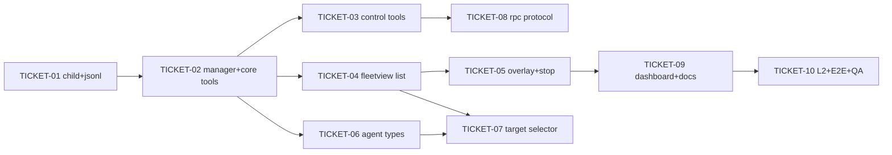

# Tasks — pi-swarm

> **STATUS:** `sliced` (2026-10-18)

> Sliced from `.skillgrid/specs/2026-10-16-pi-swarm-extension/blueprint.md`.
> Vertical tracer-bullet tickets, dependency-ordered, sized for one fresh
> agent context window.

## Epic Summary

A bundled pi extension that spawns, tracks, steers, and inspects parallel
isolated child skill-pi agents as `--mode rpc` subprocesses, with a below-
prompt FleetView, a `/swarm` dashboard, a prompt-target selector (Ctrl+Q Tab
leader, per ADR-0010), agent types from `.skill-pi/agents/`, and a versioned
cross-extension RPC protocol (`swarm:rpc:*`, v1).

## Delivery Strategy

| Field | Value |
|-------|-------|
| Estimated changed lines | ~3500 (extension source + specs, 50% tests) |
| 400-line budget risk | High |
| Chained PRs recommended | Yes |
| Suggested split | per-ticket work units committed directly to main (project delivery: `stacked-to-main`, config `delivery.chain_strategy`; no PRs — commits are the rollback boundary) |
| Delivery strategy | auto-chain |
| Chain strategy | stacked-to-main |

Decision needed before apply: No
Chained PRs recommended: Yes
Chain strategy: stacked-to-main
400-line budget risk: High

### Suggested Work Units

| Unit | Goal | Likely PR | Focused test command | Runtime harness | Rollback boundary |
|------|------|-----------|----------------------|-----------------|-------------------|
| 1 | RPC child lifecycle + JSONL codec (door check) | commit | `cd extensions/pi-swarm && npx vitest run src/child.spec.ts src/jsonl.spec.ts` | live `skill-pi --mode rpc` child (blueprint Task 1 door check) | delete `extensions/pi-swarm/src/{child,jsonl,domain}.ts*` |
| 2 | Manager + spawn/wait/list tools + deferred delivery | commit | `npx vitest run src/manager.spec.ts` | fake-child adapter (no live pi needed) | delete `src/manager.ts*` + revert `index.ts` tool block |
| 3 | Control tools + statusline | commit | `npx vitest run src/manager.spec.ts` | fake-child adapter | revert `index.ts` tool/statusline block |
| 4 | FleetView list + formatting | commit | `npx vitest run src/format.spec.ts src/ui/fleetview.spec.ts` | N/A (pure component + read model) | delete `src/format.ts*`, `src/ui/fleetview.ts*` |
| 5 | FleetView transcript overlay + stop | commit | `npx vitest run src/ui/fleetview.spec.ts` | N/A (read model stub) | revert overlay state in `fleetview.ts` |
| 6 | Agent types discovery + frontmatter | commit | `npx vitest run src/agents.spec.ts` | tmp-dir fs (no live pi) | delete `src/agents.ts*` |
| 7 | Target selector + Ctrl+Q Tab + input interception | commit | `npx vitest run src/target.spec.ts` | N/A (pure + injected planAvailable) | delete `src/target.ts*` + revert leader/input blocks; plan-build emit line reverts independently |
| 8 | Cross-extension RPC protocol (v1) | commit | `npx vitest run src/protocol.spec.ts` | in-memory fake EventBus | delete `src/protocol.ts*` |
| 9 | `/swarm` dashboard + README + root README | commit | `npx vitest run && npx tsc --noEmit -p .` | N/A | delete `src/ui/dashboard.ts*` + revert command registration |
| 10 | L2 verification + E2E + QA artifacts | commit | full L2 (blueprint Task 10 Step 2) | live E2E session (the backstop truth) | spec-zone only; no code |

> The four plain-text guard lines above are the **contract** — `skillgrid:subagent-execution` matches them literally.

## Tickets

### TICKET-01 — RPC child lifecycle + JSONL codec (door check)

- **Scope:** `domain.ts` (types + constants exactly per blueprint "Types & Constants"), `jsonl.ts` + spec, `child.ts` (`SwarmChild` RPC subprocess: spawn/steer/abort/settle, tolerant event fold) + spec with a fake-child adapter; live door check against a real `skill-pi --mode rpc` child.
- **Acceptance:** `npx vitest run` green (jsonl + child specs); live door check passes: a real child receives a `prompt` JSONL command, replies with `SWARM_DOOR_OK`, settles `done` with finalText; `~/.pi/agent` mtime unchanged; exact RPC event `type` names recorded in `report.md`.
- **SATISFIES:** R-core-spawn-wait
- **Files:** `extensions/pi-swarm/src/{domain.ts,jsonl.ts,jsonl.spec.ts,child.ts,child.spec.ts}` (+ `report.md` note for door-check evidence)
- **Size:** ~700 (M)
- **Blocks:** TICKET-02
- **Blocked by:** none
- **Precondition:** `node bin/skill-pi.js --help` exits 0 and `node_modules/@earendil-works/pi-coding-agent/dist/modes/rpc/rpc-types.d.ts` exists (the RPC surface this ticket drives)
- **Fails-when:** vitest exit ≠ 0; door check prints `DOOR_TIMEOUT` or the child exit ≠ 0; `SWARM_DOOR_OK` absent from stdout

### TICKET-02 — SwarmManager + core tools + deferred result delivery

- **Scope:** `manager.ts` (registry, MAX_RUNNING queue-not-reject, MAX_TRACKED LRU by settledAt, wait-interest/consumed semantics, truncation budgets incl. proportional wait-budget rule) + spec (fake-child factory); `index.ts` extension factory: package scaffold (package.json/tsconfig/vitest.config, house shape per `extensions/todo/`), `swarm_spawn`/`swarm_wait`/`swarm_list` tools, `swarm-result` message renderer, deferred `deliver` via `pi.sendMessage({deliverAs:"followUp", triggerTurn:true})` with empty-finalText fallback, `SKILL_PI_SWARM`/`SKILL_PI_SWARM_MAX` env reads, `session_shutdown` dispose on `reason === "quit"` only, manager keyed by session id, skill-pi executable path resolution per blueprint Task 2 Step 4.
- **Acceptance:** `npx vitest run src/manager.spec.ts` green (cap/queue, waitFor-consume, unconsumed deliver-once, cancel bound, LRU, check non-consuming); `npx tsc --noEmit -p .` clean; in a live session `swarm_spawn` returns an id immediately and the settled result triggers exactly one follow-up turn (verified in TICKET-10 E2E).
- **SATISFIES:** R-core-spawn-wait, R-child-cap
- **Files:** `extensions/pi-swarm/{package.json,tsconfig.json,vitest.config.ts,index.ts,src/manager.ts,src/manager.spec.ts}`
- **Size:** ~900 (M)
- **Blocks:** TICKET-03, TICKET-04
- **Blocked by:** TICKET-01

### TICKET-03 — Control tools: check/send/cancel + swarm statusline

- **Scope:** register `swarm_check` (≤2KB AND ≤20-line preview, non-consuming, unknown-id error lists known ids), `swarm_send` (steer while running / follow_up after settle), `swarm_cancel` (bounded abort + SIGKILL fallback, per-id outcome, `was already <status>`); `ctx.ui.setStatus("swarm", …)` driven by `manager.subscribe`, cleared when empty; manager.spec extensions incl. cancel-of-queued (queue promotes next).
- **Acceptance:** `npx vitest run` green incl. new cases: send-while-running writes `steer`, send-after-settle writes `follow_up`, check bounds + non-consuming, cancel-queued promotes next; tsc clean.
- **SATISFIES:** R-check-and-list, R-send-steers, R-cancel-aborts
- **Files:** `extensions/pi-swarm/index.ts`, `extensions/pi-swarm/src/manager.spec.ts`
- **Size:** ~450 (S)
- **Blocks:** TICKET-08
- **Blocked by:** TICKET-02

### TICKET-04 — FleetView: below-prompt list + formatting

- **Scope:** `format.ts` (elapsed/tokens/row) + spec; `ui/fleetview.ts` as a pi-tui Component over the manager read model (main row + one row per agent, earliest-launched first, glyphs, selection marker, hint row); mounted via `ctx.ui.setWidget` placement `belowEditor`; empty-prompt key capture: `↓`/`←` enter, `↑`/`↓` move, `Esc`/`↑`-above-main return, `x` stop — suppressed while the Ctrl+Q leader is armed.
- **Acceptance:** `npx vitest run src/format.spec.ts src/ui/fleetview.spec.ts` green (format values + row rendering + key transitions on a stub read model); tsc clean; in a live session with a running child the list renders below the prompt (recorded in TICKET-10 E2E).
- **SATISFIES:** R-fleetview-visible
- **Files:** `extensions/pi-swarm/src/{format.ts,format.spec.ts,ui/fleetview.ts,ui/fleetview.spec.ts}`, `extensions/pi-swarm/index.ts`
- **Size:** ~600 (M)
- **Blocks:** TICKET-05
- **Blocked by:** TICKET-02

### TICKET-05 — FleetView: live transcript overlay + stop

- **Scope:** overlay mode in the FleetView Component: selected agent's transcript (sanitized: strip ANSI, one-line tool entries), auto-follow with scroll-up-to-pause, 50ms render throttle; `x` two-press confirm → `manager.cancel(id)`; reuse `cardTop`/`cardBottom` from `../skill-pi-tui/src/card.ts` when importable.
- **Acceptance:** `npx vitest run src/ui/fleetview.spec.ts` green (new lines render on snapshot update, auto-follow, x-twice cancels, x-once doesn't); tsc clean.
- **SATISFIES:** R-fleetview-open-transcript, R-fleetview-stop
- **Files:** `extensions/pi-swarm/src/ui/fleetview.ts`, `extensions/pi-swarm/src/ui/fleetview.spec.ts`
- **Size:** ~450 (S)
- **Blocks:** TICKET-09
- **Blocked by:** TICKET-04

### TICKET-06 — Agent types: discovery + frontmatter

- **Scope:** `agents.ts` (`discoverAgentTypes(projectDir, agentDir)` reading `.skill-pi/agents/*.md` then `<agentDir>/agents/*.md`, project wins on name clash, parse with pi's `parseFrontmatter`, skip-unparseable with console.warn, `resolveAgentType`) + spec (tmp dirs); wire into `swarm_spawn` `agent_type` (unknown → tool error listing known names; resolved → systemPrompt prepended with `## Agent instructions` marker + blank line + prompt).
- **Acceptance:** `npx vitest run src/agents.spec.ts` green (project-only, global-only, clash→project, max_turns, name-override, broken frontmatter skipped + warn, body = systemPrompt); tsc clean.
- **SATISFIES:** R-agent-types-discovered
- **Files:** `extensions/pi-swarm/src/{agents.ts,agents.spec.ts}`, `extensions/pi-swarm/index.ts`
- **Size:** ~400 (S)
- **Blocks:** TICKET-07
- **Blocked by:** TICKET-02

### TICKET-07 — Prompt-target selector: Ctrl+Q Tab + build/plan/agent cycle

- **Scope:** `target.ts` (`createTargetSelector`, cycle build → plan-if-available → agents load order → build; session-scoped in-memory, default `build`) + spec; armed-leader listener in `index.ts` per ADR-0010 mechanics (raw `ctx.ui.onTerminalInput`, 2s one-key window mirroring `extensions/command-plate/index.ts:263-278`, `Tab` → cycle, ignore others while armed, armed hint); `SKILL_PI_SWARM_TARGET_KEY` (action key only, default `tab`, `off` disables); `swarm:plan-present` lazy probe + `SKILL_PI_PLAN_BUILD=1` override; `ctx.ui.setStatus("swarm-target", "⌁ " + current)` with per-target color; input interception: `source === "interactive"` + agent target + non-empty text + FleetView overlay NOT open → `manager.spawn` + notify + `{action: "handled"}`; **plus the one additive plan-build line**: `pi.events.emit("swarm:plan-present", …)` on session start (own work-unit commit so plan-build stays independently revertable).
- **Acceptance:** `npx vitest run src/target.spec.ts` green (empty agents → `["build"]`; with agents+plan → `["build","plan","auditor","explorer"]`; cycle wraps; matchesAgent); tsc clean; plan-build suite still green after its one-line change.
- **SATISFIES:** R-target-default-build, R-target-cycle, R-target-spawns
- **Files:** `extensions/pi-swarm/src/{target.ts,target.spec.ts}`, `extensions/pi-swarm/index.ts`, `extensions/plan-build/index.ts` (one line, separate commit)
- **Size:** ~550 (M)
- **Blocks:** none
- **Blocked by:** TICKET-04, TICKET-06
- **Fails-when:** target.spec or plan-build `index.spec.ts` exit ≠ 0

### TICKET-08 — Cross-extension RPC protocol (v1)

> ⚠ one-way: the RPC contract. Channel names `swarm:rpc:ping|spawn|steer|consume|stop`, envelope `{v, reqId, type, payload}`, reply on `swarm:rpc:reply`, `v: 1`, and the `swarm:*` lifecycle events + `swarm:usage` (per-run deltas) are public from the moment another extension consumes them — STOP and confirm before renaming any of them.

- **Scope:** `protocol.ts` (`installSwarmProtocol(bus, manager)`: envelope in/out, unknown-v → version-error reply with no side effect, spawn/steer/consume/stop routing into the same manager API the tools use — consume is non-blocking + marks consumed, `swarm:ready` on session start, lifecycle events on transitions) + spec (in-memory fake EventBus, seeded manager spies); wired in `index.ts` at session start, disposed on shutdown.
- **Acceptance:** `npx vitest run src/protocol.spec.ts` green (ping counts, spawn→id, steer→send, consume→snapshot+consumed, stop→cancel, v:99 → version error + no manager call, each lifecycle event emitted exactly once per transition); tsc clean.
- **SATISFIES:** R-rpc-protocol, R-rpc-version
- **Files:** `extensions/pi-swarm/src/{protocol.ts,protocol.spec.ts}`, `extensions/pi-swarm/index.ts`
- **Size:** ~500 (M)
- **Blocks:** none
- **Blocked by:** TICKET-03
- **Reversibility:** one-way

### TICKET-09 — `/swarm` dashboard + README + root README entry

- **Scope:** `ui/dashboard.ts` (fullscreen list of all tracked agents; `j/k`/arrows, `Enter` → takeover reusing the TICKET-05 overlay component, `x` → cancel, `Esc` close); `/swarm` command registration (non-TUI → prints `swarm_list` text, typically empty — documented); `extensions/pi-swarm/README.md` (house style: what you get, install, how-it-works diagram, env table `SKILL_PI_SWARM`/`SKILL_PI_SWARM_MAX`/`SKILL_PI_SWARM_TARGET_KEY`, RPC protocol reference, license/sources); root `README.md` bundled-extensions bullet.
- **Acceptance:** `npx vitest run && npx tsc --noEmit -p .` green in the extension dir; root README entry present; README documents the Ctrl+Q Tab binding and the `app.thinking.cycle` note is gone (shift+tab untouched).
- **SATISFIES:** (management surface for all fleet/dashboard scenarios — no new scenario)
- **Files:** `extensions/pi-swarm/src/ui/dashboard.ts`, `extensions/pi-swarm/index.ts`, `extensions/pi-swarm/README.md`, `README.md`
- **Size:** ~600 (M)
- **Blocks:** TICKET-10
- **Blocked by:** TICKET-05

### TICKET-10 — L2 verification + door-check E2E + QA artifacts

- **Scope:** live E2E (the backstop truth): real session, `swarm_spawn` → settle → `swarm-result` follow-up turn visible in the transcript; `~/.pi/agent` mtime unchanged; L2 run (extension vitest ≥ 40 tests, tsc clean, root `node --test` unchanged pass count); `report.md` QA-gate render + door-check/E2E evidence + recorded unknowns (RPC event names, system-prompt mechanism, plan-present probe behavior, FleetView placement).
- **Acceptance:** all L2 commands green; `report.md` exists with a shippable verdict and E2E evidence block; root suite pass count unchanged (0 new fails).
- **SATISFIES:** R-core-spawn-wait (backstop confirmation), all (final gate)
- **Files:** `.skillgrid/specs/2026-10-16-pi-swarm-extension/report.md`
- **Size:** ~150 (S, spec-zone)
- **Blocks:** none (QA/review/ship follow)
- **Blocked by:** TICKET-09

## Dependency Graph

## Execution Order

- **Wave 1:** TICKET-01
- **Wave 2:** TICKET-02
- **Wave 3 (parallel):** TICKET-03, TICKET-04, TICKET-06
- **Wave 4 (parallel):** TICKET-05 (after 04), TICKET-07 (after 04+06), TICKET-08 (after 03)
- **Wave 5:** TICKET-09 (after 05)
- **Wave 6:** TICKET-10 (after 09)

> **Acceptance-first (BDD is always on):** every ticket's `SATISFIES`
> scenario in `acceptance.feature` is confirmed RED (spec written, failing)
> before the implementation step of that ticket.

## Slicing Notes

- Build shape **Tracer thread**: TICKET-01 is the thin end-to-end path (tool
  boundary → manager seam → RPC subprocess → settle → delivery path), then
  waves thicken it (control, UI, types, protocol).
- **Parallelism within waves is real but bounded:** TICKET-03/04/06 all touch
  `index.ts`. Wave 3 runs them in parallel worktrees; the `index.ts` merge is
  mechanical (disjoint tool-registration blocks) — if a conflict appears,
  serialize 03 → 04 → 06 in place (record in `progress.md`).
- **One additive line outside the extension** (plan-build `swarm:plan-present`
  emit, TICKET-07) is its own commit so the two extensions revert
  independently — the only cross-extension touch in this change.
- **One-way door:** TICKET-08 (RPC contract) — the executor stops for user
  confirmation before renaming/reshaping any `swarm:rpc:*` channel or
  envelope field, per the blueprint's one-way tag.
- Size estimates are source+test lines; the 50% test share is assumed per
  project TDD convention.
